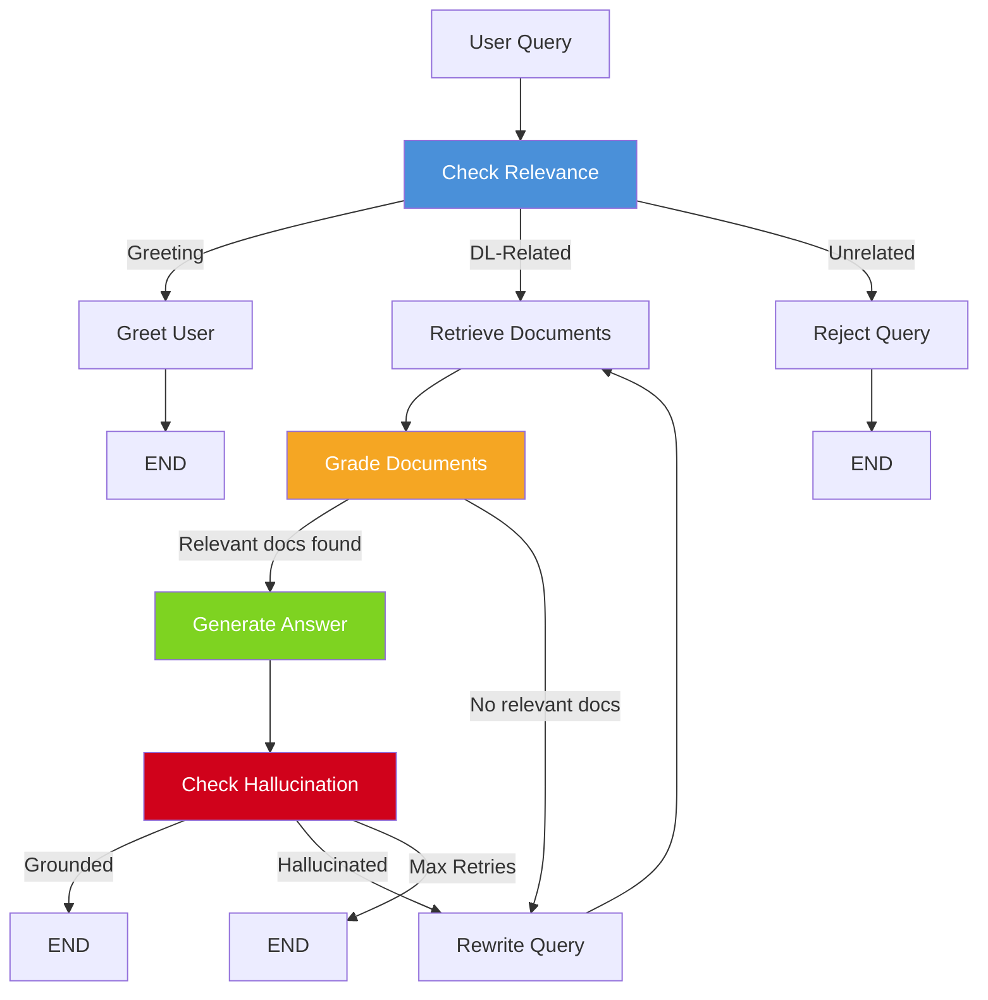

# 🧠 Deep Learning Tutor — Agentic RAG Chatbot

An intelligent, conversational Deep Learning tutor powered by an **Agentic Retrieval-Augmented Generation (RAG)** pipeline. The system uses **LangGraph** to orchestrate a multi-step reasoning workflow that retrieves relevant content from the *Deep Learning* textbook by Ian Goodfellow, Yoshua Bengio, and Aaron Courville (MIT Press, 2017), grades document relevance, generates grounded answers, and self-corrects through hallucination detection — all exposed via a **FastAPI** backend.

> **Course Project** — Deep Learning (DL)

---

## 📑 Table of Contents

- [Features](#-features)
- [Architecture Overview](#-architecture-overview)
- [Agentic RAG Workflow](#-agentic-rag-workflow)
- [Tech Stack](#-tech-stack)
- [Project Structure](#-project-structure)
- [Getting Started](#-getting-started)
  - [Prerequisites](#prerequisites)
  - [Installation](#installation)
  - [Environment Variables](#environment-variables)
  - [Running the Server](#running-the-server)
- [API Reference](#-api-reference)
- [How It Works — Component Deep Dive](#-how-it-works--component-deep-dive)
  - [1. Document Ingestion & Embedding](#1-document-ingestion--embedding)
  - [2. Relevance Classification (Query Gate)](#2-relevance-classification-query-gate)
  - [3. Document Retrieval & Grading](#3-document-retrieval--grading)
  - [4. Answer Generation](#4-answer-generation)
  - [5. Hallucination Detection](#5-hallucination-detection)
  - [6. Query Rewriting with Memory](#6-query-rewriting-with-memory)
  - [7. Conversation Memory](#7-conversation-memory)
- [Deployment](#-deployment)
  - [Docker](#docker)
  - [Azure Container Apps](#azure-container-apps)
- [Key Design Decisions](#-key-design-decisions)
- [Limitations & Future Work](#-limitations--future-work)
- [References](#-references)

---

## ✨ Features

| Feature | Description |
|---------|-------------|
| **Agentic RAG Pipeline** | Multi-step LangGraph workflow with conditional routing, self-correction loops, and retry logic |
| **Relevance Gating** | Classifies user queries into *greeting*, *DL-related*, or *unrelated* before entering the RAG pipeline — unrelated queries are rejected immediately |
| **Document Grading** | Each retrieved chunk is individually graded for relevance before being used for generation |
| **Hallucination Detection** | Post-generation check ensures the answer is grounded in the retrieved context; if not, the system self-corrects |
| **Query Rewriting** | Grammar-only correction and pronoun resolution using conversation history — preserves user intent |
| **Conversation Memory** | Maintains chat history across turns using LangGraph's `MemorySaver` checkpointer |
| **Greeting Handling** | Responds warmly to greetings (hi, thanks, bye) without triggering the full RAG pipeline |
| **Auto-Ingestion** | Automatically downloads and embeds the Goodfellow textbook on first run; skips on subsequent runs using persistent ChromaDB |
| **REST API** | Clean FastAPI backend with CORS, health checks, and Pydantic validation |
| **Docker-Ready** | Production Dockerfile included for containerized deployment |

---

## 🏗 Architecture Overview

```
┌─────────────────────────────────────────────────────────────────┐
│                        Frontend (Next.js)                       │
│                    https://dl-tutor.novaric.in                  │
└──────────────────────────┬──────────────────────────────────────┘
                           │ POST /chat
                           ▼
┌─────────────────────────────────────────────────────────────────┐
│                   FastAPI Backend (main.py)                      │
│  • CORS middleware     • Pydantic validation    • /health        │
└──────────────────────────┬──────────────────────────────────────┘
                           │
                           ▼
┌─────────────────────────────────────────────────────────────────┐
│              LangGraph Agentic Workflow (agent.py)               │
│                                                                  │
│  check_relevance → [greeting] → greet → END                     │
│                  → [relevant] → retrieve → grade_documents       │
│                  → [not_relevant] → reject → END                 │
│                                                                  │
│  grade_documents → [docs found] → generate → hallucination_check │
│                  → [no docs]    → rewrite_query → retrieve ↺     │
│                                                                  │
│  hallucination_check → [grounded] → END                          │
│                      → [hallucinated] → rewrite_query → retrieve↺│
│                      → [max_retries] → END                       │
└──────────────────────────┬──────────────────────────────────────┘
                           │
              ┌────────────┼────────────┐
              ▼            ▼            ▼
         ChromaDB     OpenAI API    Goodfellow
        (Vector DB)   (GPT-4o-mini)  Textbook PDF
```

---

## 🔄 Agentic RAG Workflow

The core of this project is a **stateful, multi-agent graph** built with LangGraph. Unlike a simple retrieve-and-generate RAG, this system makes autonomous decisions at each step:



**Key Decision Points:**
1. **Relevance Gate** — Should we even process this query?
2. **Document Grading** — Are the retrieved chunks actually useful?
3. **Hallucination Check** — Is the generated answer grounded in facts?

Each decision point can trigger a **self-correction loop** (up to 3 retries) where the query is rewritten and documents are re-retrieved.

---

## 🛠 Tech Stack

| Component | Technology | Purpose |
|-----------|-----------|---------|
| **LLM** | OpenAI GPT-4o-mini | Query classification, document grading, answer generation, hallucination detection |
| **Embeddings** | OpenAI Embeddings | Text-to-vector conversion for semantic search |
| **Vector Database** | ChromaDB | Persistent storage and retrieval of document embeddings |
| **Orchestration** | LangGraph | Stateful, graph-based agentic workflow with conditional routing |
| **Framework** | LangChain | Document loading, text splitting, prompt templates, output parsing |
| **API** | FastAPI | REST API with async support, CORS, and auto-documentation |
| **PDF Processing** | PyPDF | Loading and parsing the Deep Learning textbook |
| **Containerization** | Docker | Production-ready container for deployment |
| **Python** | 3.11 | Runtime |

---

## 📁 Project Structure

```
dl-tutor-rag/
├── agent.py              # Core agentic RAG pipeline (LangGraph workflow)
├── main.py               # FastAPI server with /chat and /health endpoints
├── requirements.txt      # Python dependencies
├── Dockerfile            # Production container configuration
├── .dockerignore         # Files excluded from Docker builds
├── .env                  # Environment variables (not tracked in git)
├── .gitignore            # Git ignore rules
├── data/                 # Development data & notebooks
│   ├── notebook.ipynb    # Jupyter notebook used for prototyping the RAG pipeline
│   ├── deep_learning.pdf # Local copy of the textbook (auto-downloaded)
│   └── chroma_db/        # Development vector store
├── notebooks/            # Additional notebooks
├── src/                  # Source modules (reserved for future modularization)
│   ├── app.py
│   └── ingestion.py
├── chroma_db/            # Persistent ChromaDB vector store (auto-generated)
└── llm_prompts/          # Prompt templates (reserved for future use)
```

### File Descriptions

| File | Lines | Description |
|------|-------|-------------|
| `agent.py` | ~395 | The heart of the system. Defines the complete LangGraph workflow: document ingestion, relevance checking, retrieval, grading, generation, hallucination detection, query rewriting, and graph compilation. |
| `main.py` | ~81 | FastAPI application that wraps the LangGraph agent into a REST API. Handles request/response validation, CORS configuration, and error handling. |
| `requirements.txt` | 12 | All Python package dependencies needed to run the project. |
| `Dockerfile` | 31 | Multi-stage Docker build using `python:3.11-slim`. Installs system dependencies, Python packages, and runs the Uvicorn server. |
| `data/notebook.ipynb` | — | Jupyter notebook used during development to prototype and test the RAG pipeline before converting to the production `agent.py`. |

---

## 🚀 Getting Started

### Prerequisites

- **Python 3.11+**
- **OpenAI API Key** ([Get one here](https://platform.openai.com/api-keys))
- **Git**

### Installation

```bash
# 1. Clone the repository
git clone https://github.com/udaygupta8899/dl-tutor-rag.git
cd dl-tutor-rag

# 2. Create and activate a virtual environment
python -m venv venv
source venv/bin/activate        # Linux/Mac
# venv\Scripts\activate         # Windows

# 3. Install dependencies
pip install -r requirements.txt
```

### Environment Variables

Create a `.env` file in the project root:

```env
OPENAI_API_KEY=sk-your-openai-api-key-here
```

> ⚠️ **Important:** The `.env` file is excluded from version control via `.gitignore`. Never commit your API keys.

### Running the Server

```bash
# Development mode (with hot-reload)
uvicorn main:api --reload --host 0.0.0.0 --port 8000
```

**First run behavior:**
1. Downloads the Goodfellow Deep Learning textbook (~16 MB PDF) from GitHub
2. Splits the PDF into ~3,053 text chunks (1000 chars each, 100 char overlap)
3. Embeds all chunks using OpenAI Embeddings and stores them in ChromaDB
4. Starts the FastAPI server on `http://localhost:8000`

**Subsequent runs:** Loads the existing ChromaDB database instantly (skips download and ingestion).

---

## 📡 API Reference

### `POST /chat`

Send a question to the Deep Learning tutor.

**Request:**
```json
{
  "question": "What is backpropagation?",
  "thread_id": "user-session-123"
}
```

**Response:**
```json
{
  "answer": "Backpropagation is an algorithm used to compute gradients...",
  "thread_id": "user-session-123"
}
```

| Field | Type | Description |
|-------|------|-------------|
| `question` | `string` | The user's question |
| `thread_id` | `string` | Unique session ID for maintaining conversation history across requests |

### `GET /health`

Health check endpoint.

**Response:**
```json
{
  "status": "healthy"
}
```

### Interactive API Docs

Once the server is running, visit:
- **Swagger UI:** `http://localhost:8000/docs`
- **ReDoc:** `http://localhost:8000/redoc`

---

## 🔍 How It Works — Component Deep Dive

### 1. Document Ingestion & Embedding

```python
# Text splitting configuration
chunk_size = 1000    # Characters per chunk
chunk_overlap = 100  # Overlap between consecutive chunks
```

- **Source:** *Deep Learning* by Goodfellow, Bengio & Courville (MIT Press, 2017) — auto-downloaded from GitHub
- **Loader:** `PyPDFLoader` extracts text from each page
- **Splitter:** `RecursiveCharacterTextSplitter` creates ~3,053 chunks with semantic boundaries
- **Embeddings:** OpenAI's embedding model converts each chunk to a high-dimensional vector
- **Storage:** ChromaDB persists the vectors to `./chroma_db/` for instant reloading
- **Retriever:** Top-4 most similar chunks are retrieved per query (`k=4`)

### 2. Relevance Classification (Query Gate)

The first node in the graph classifies every incoming message into one of three categories:

| Classification | Action | Example |
|---------------|--------|---------|
| `greeting` | Respond warmly, skip RAG | "Hi!", "Thanks!", "Good morning" |
| `yes` (relevant) | Proceed to full RAG pipeline | "What is a CNN?", "Explain dropout" |
| `no` (unrelated) | Return rejection message, skip RAG | "What's the weather?", "Tell me a joke" |

This prevents unrelated queries from ever entering the retrieval pipeline, saving API calls and ensuring focused responses.

### 3. Document Retrieval & Grading

- **Retrieval:** Fetches the top 4 semantically similar chunks from ChromaDB
- **Grading:** Each chunk is individually evaluated by the LLM for relevance to the specific question
- **Decision:**
  - If relevant chunks exist → proceed to generation
  - If no relevant chunks → rewrite the query and retry (up to 3 attempts)

### 4. Answer Generation

Uses a structured system/human prompt template:
- **System message:** Defines the tutor's role, rules for when to decline, and response style
- **Human message:** Provides the retrieved context and the student's question
- Strictly answers from the provided context — won't fabricate information

### 5. Hallucination Detection

After generation, a separate LLM call evaluates whether the answer is:
- **Grounded** in the retrieved facts → return the answer
- **Hallucinated** (contradicts or goes beyond the context) → rewrite query and retry
- **Max retries reached** (3 attempts) → return the best available answer

### 6. Query Rewriting with Memory

When documents are irrelevant or hallucination is detected, the query is refined:
- ✅ Fixes grammar and spelling errors
- ✅ Resolves pronouns using conversation history (e.g., "What about it?" → "What about backpropagation?")
- ❌ Does **NOT** add DL terminology the user didn't use
- ❌ Does **NOT** transform the question into a different question

### 7. Conversation Memory

- Implemented via LangGraph's `MemorySaver` checkpointer
- Each `thread_id` maintains its own independent conversation history
- History is used for pronoun resolution in query rewriting
- Enables multi-turn conversations (e.g., "Tell me more about that")

---

## 🐳 Deployment

### Docker

```bash
# Build the image
docker build -t dl-tutor-rag .

# Run locally
docker run -p 8000:8000 -e OPENAI_API_KEY=sk-your-key dl-tutor-rag

# Test
curl http://localhost:8000/health
```

### Azure Container Apps

```bash
# 1. Login and create resources
az login
az group create --name dl-tutor-rg --location centralindia
az acr create --resource-group dl-tutor-rg --name dltutoracr --sku Basic --admin-enabled true

# 2. Build, tag, and push
az acr login --name dltutoracr
docker tag dl-tutor-rag dltutoracr.azurecr.io/dl-tutor-rag:latest
docker push dltutoracr.azurecr.io/dl-tutor-rag:latest

# 3. Deploy
az containerapp create \
  --name dl-tutor-api \
  --resource-group dl-tutor-rg \
  --environment dl-tutor-env \
  --image dltutoracr.azurecr.io/dl-tutor-rag:latest \
  --target-port 8000 \
  --ingress external \
  --env-vars "OPENAI_API_KEY=<your-key>"
```

---

## 🎯 Key Design Decisions

| Decision | Rationale |
|----------|-----------|
| **LangGraph over LangChain LCEL** | LangGraph provides stateful, graph-based orchestration with conditional routing — essential for the self-correction loops and multi-path decision making in this project |
| **Relevance gate before retrieval** | Prevents wasting embedding API calls and retrieval compute on off-topic queries. Also prevents the LLM from hallucinating DL answers to unrelated questions |
| **Grammar-only query rewriting** | Earlier approach rewrote queries into "DL terminology" which transformed unrelated questions into DL questions. The fix preserves user intent and only corrects grammar/pronouns |
| **GPT-4o-mini** | Balances cost and capability — sufficient for classification, grading, and educational explanations without the expense of GPT-4o |
| **ChromaDB with persistence** | Avoids re-embedding ~3,053 chunks on every restart. The vector store is saved to disk and loaded instantly on subsequent runs |
| **Chunk size of 1000** | Larger than typical RAG chunks (500) to capture full paragraphs and mathematical explanations common in the textbook |
| **Max 3 retries** | Prevents infinite loops in the rewrite-retrieve-generate cycle while giving the system enough chances to self-correct |
| **Separate system/human prompts** | Using `ChatPromptTemplate.from_messages` with distinct system and human roles gives the LLM clearer instruction separation than a single template string |

---

## ⚠️ Limitations & Future Work

- **Ephemeral vector store in Docker:** ChromaDB data is lost when the container restarts. A production deployment should mount a persistent volume or use a managed vector database
- **In-memory conversation history:** `MemorySaver` stores chat history in RAM — lost on server restart. Could be replaced with Redis or a database-backed checkpointer
- **Single textbook source:** Currently limited to the Goodfellow textbook. Could be extended to ingest multiple textbooks or research papers
- **No streaming responses:** The API returns the complete answer after all graph nodes finish. Streaming would improve perceived latency
- **No authentication:** The API is open. Production deployment should add API key authentication or OAuth

---

## 📚 References

1. Goodfellow, I., Bengio, Y., & Courville, A. (2016). *Deep Learning*. MIT Press. [https://www.deeplearningbook.org/](https://www.deeplearningbook.org/)
2. LangGraph Documentation — [https://langchain-ai.github.io/langgraph/](https://langchain-ai.github.io/langgraph/)
3. LangChain Documentation — [https://python.langchain.com/](https://python.langchain.com/)
4. ChromaDB Documentation — [https://docs.trychroma.com/](https://docs.trychroma.com/)
5. FastAPI Documentation — [https://fastapi.tiangolo.com/](https://fastapi.tiangolo.com/)
6. Lewis, P., et al. (2020). *Retrieval-Augmented Generation for Knowledge-Intensive NLP Tasks*. NeurIPS 2020.

---

## 📄 License

This project is for educational purposes as part of a Deep Learning course.

---

<p align="center">
  Built with ❤️ using LangGraph, LangChain, ChromaDB, and FastAPI
</p>
